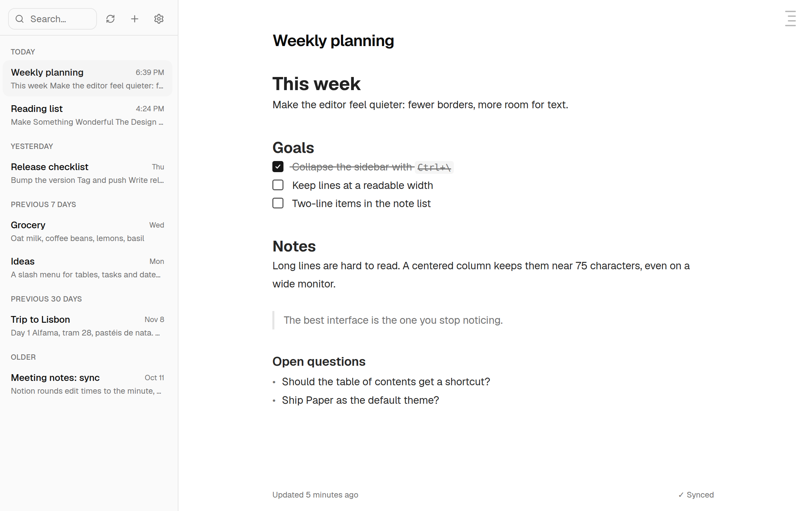

# Monolog

A small, fast desktop note app that syncs to **Notion**.
Built with Tauri 2, React, TypeScript and Tailwind.

Notes save locally first, so typing is instant and the app works offline.
They sync to a Notion database in the background.



<table>
  <tr>
    <td></td>
    <td></td>
  </tr>
  <tr>
    <td align="center">Paper Dark theme · table of contents</td>
    <td align="center">Focus mode (<code>Ctrl/Cmd + \</code>) · Paper theme</td>
  </tr>
</table>

## Features

- Local-first notes with background Notion sync and offline support
- Images: paste, drag & drop, resize by dragging; synced as Notion image blocks
- Notes show up in Notion as real pages (headings, lists, quotes, images)
- Instant local search
- Light / dark / system theme, plus Paper (after MiaoYan) and other palettes
- Shortcuts: `Ctrl/Cmd + N` new note · `S` save · `F` search · `\` toggle sidebar · `W` close

## Getting started

1. Create an **internal integration** at <https://www.notion.so/profile/integrations> and copy its API key.
2. In Notion, open a page and connect your integration to it (**••• → Connections**).
3. Launch Monolog and paste the key. The app finds or creates a `random_notes_desktop` database under that page.

## Development

Requires Node.js 20+, Rust (stable), and on Linux:
`webkit2gtk-4.1-dev build-essential libxdo-dev libssl-dev librsvg2-dev`.

```sh
npm install
npm run tauri dev     # run
npm test              # tests
npm run tauri build   # build → src-tauri/target/release/bundle/
```

## Releasing

Bump the version in `src-tauri/tauri.conf.json`, then push a matching tag:

```sh
git tag v0.2.4 && git push origin v0.2.4
```

GitHub Actions then builds for Linux, macOS (Apple Silicon) and Windows, and publishes a GitHub Release.
The macOS and Windows builds are unsigned, so Gatekeeper or SmartScreen will warn on first launch.

## Security

The Notion API key is stored in your OS keychain. Every Notion request is made from Rust, so the key never reaches the web view.
If a key leaks, revoke it in Notion's integration settings.

## Troubleshooting

| Problem | Fix |
| --- | --- |
| "No accessible parent page was found" | Connect a Notion page to your integration (step 2 above). |
| Notes stopped syncing | Settings → **Test Connection** |
| Stale data | Settings → **Clear Local Cache** |
