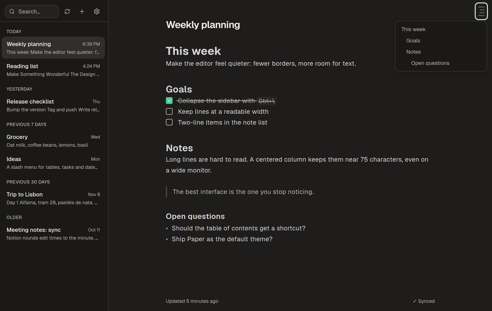
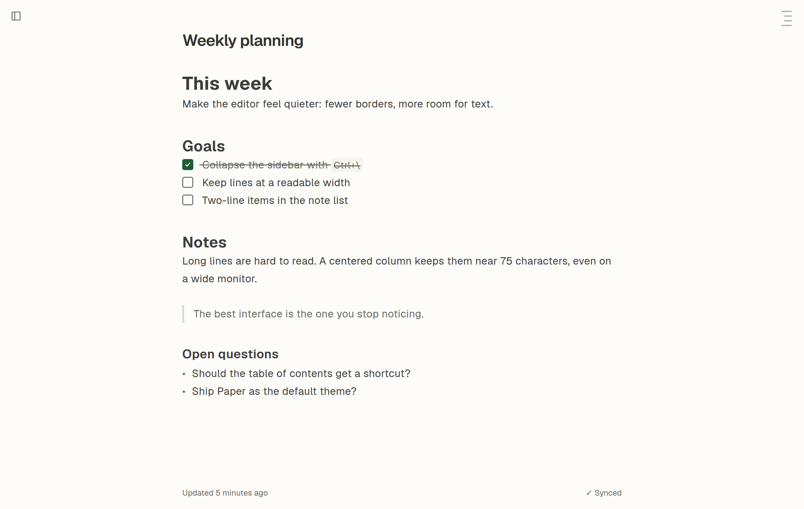

# Monolog

A small, fast desktop note app that syncs to **Notion**.

Notes save on your computer first, so typing is instant and the app works offline.
They sync to a Notion database in the background.


<table>
  <tr>
    <td></td>
    <td></td>
  </tr>
  <tr>
    <td align="center">Paper Dark theme · table of contents</td>
    <td align="center">Focus mode (<code>Ctrl/Cmd + \</code>) · Paper theme</td>
  </tr>
</table>

## Contents

- [Features](#features)
- [Install](#install)
- [Connect to Notion](#connect-to-notion)
- [Keyboard shortcuts](#keyboard-shortcuts)
- [Troubleshooting](#troubleshooting)
- [Privacy and security](#privacy-and-security)
- [Development](#development)
- [Releasing](#releasing)

## Features

**Writing**
- Markdown with live preview: headings, lists, checkboxes, quotes and code render as you type
- Images: paste or drag them in, and drag the edge to resize
- `Tab` / `Shift + Tab` nests lines, which show up as nested blocks in Notion
- Table of contents for notes with two or more headings
- Focus mode hides the sidebar

**Sync**
- Local-first: works offline and syncs when you're back online
- Notes appear in Notion as real pages, not plain text
- Edits made in Notion come back to the app on the next sync

**Look**
- Themes: System, Light, Dark, Paper, Paper Dark, Nord, Dracula, Gruvbox, Catppuccin Mocha, Solarized Light
- Note list with a short preview, grouped by date
- Instant search across titles and text

## Install

Download the latest version from [Releases](https://github.com/devded/NotionNote/releases):

| System | File |
| --- | --- |
| Linux | `Monolog-linux-x86_64.deb` or `.AppImage` |
| macOS (Apple Silicon) | `Monolog-macos-arm64.dmg` |
| Windows | `Monolog-windows-x86_64.msi` or `.exe` |

On Linux, install the `.deb` with:

```sh
sudo apt install ./Monolog-linux-x86_64.deb
```

The macOS and Windows builds are unsigned, so Gatekeeper or SmartScreen will warn on first launch.

## Connect to Notion

1. Create an **internal integration** at <https://www.notion.so/profile/integrations> and copy its API key.
2. In Notion, open a page and connect your integration to it (**••• → Connections**).
3. Open Monolog and paste the key. The app finds or creates a `random_notes_desktop` database under that page.

## Keyboard shortcuts

`Ctrl` on Linux and Windows, `Cmd` on macOS.

| Shortcut | Action |
| --- | --- |
| `Ctrl/Cmd + N` | New note |
| `Ctrl/Cmd + S` | Save now |
| `Ctrl/Cmd + R` or `F5` | Sync now |
| `Ctrl/Cmd + F` | Search |
| `Ctrl/Cmd + \` | Show or hide the sidebar |
| `Ctrl/Cmd + W` | Close the window |
| `Tab` / `Shift + Tab` | Indent or outdent the current line |

## Troubleshooting

| Problem | Fix |
| --- | --- |
| "No accessible parent page was found" | Connect a Notion page to your integration (step 2 of [Connect to Notion](#connect-to-notion)). |
| Notes stopped syncing | Settings → **Test Connection** |
| Stale data | Settings → **Clear Local Cache** |

## Privacy and security

- Your Notion API key is stored in your OS keychain.
- Every Notion request is made from the Rust backend, so the key never reaches the app's web view.
- Notes are stored locally and sent only to your own Notion workspace.
- If a key leaks, revoke it in Notion's integration settings.

## Development

Built with Tauri 2, React, TypeScript and Tailwind.

Requirements: Node.js 20+, Rust (stable), and on Linux:
`webkit2gtk-4.1-dev build-essential libxdo-dev libssl-dev librsvg2-dev`.

```sh
npm install
npm run tauri dev     # run the app
npm test              # run tests
npm run tauri build   # build → src-tauri/target/release/bundle/
```

## Releasing

1. Bump the version in `package.json`, `src-tauri/tauri.conf.json` and `src-tauri/Cargo.toml`, and in the two lock files.
2. Push a matching tag:

   ```sh
   git tag v0.3.0 && git push origin v0.3.0
   ```

GitHub Actions builds for Linux, macOS (Apple Silicon) and Windows, then publishes a GitHub Release.
The release fails if the tag doesn't match the version in `tauri.conf.json`.
